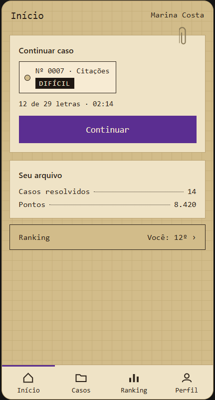
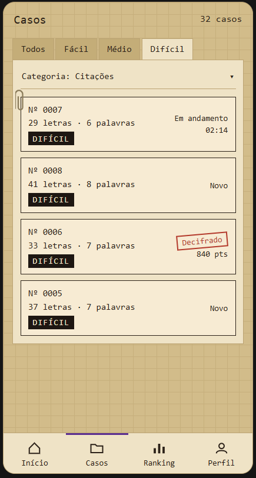
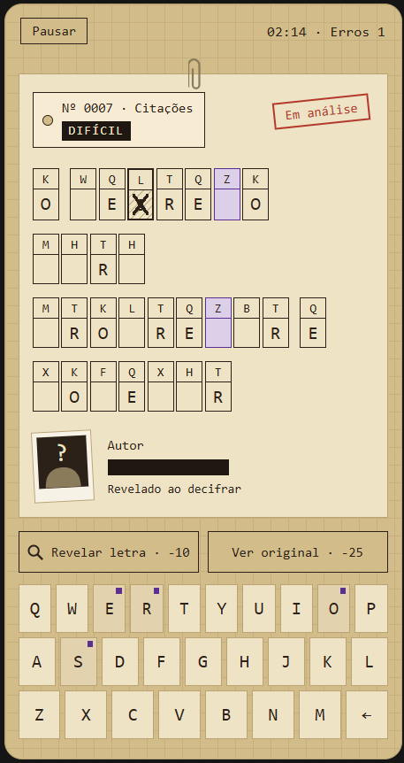
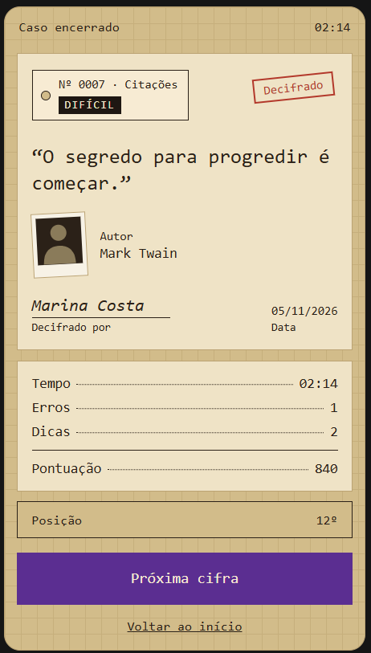
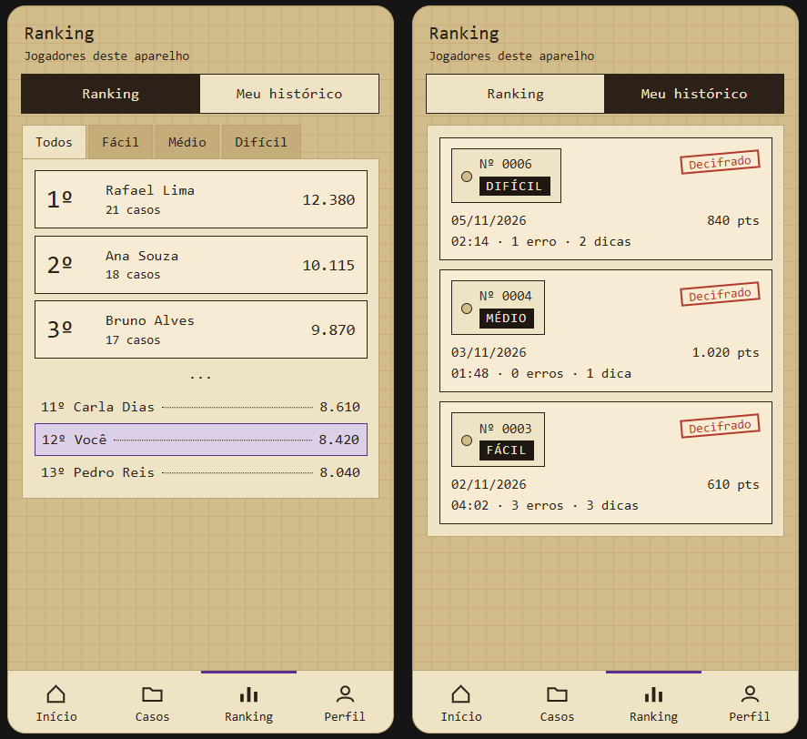
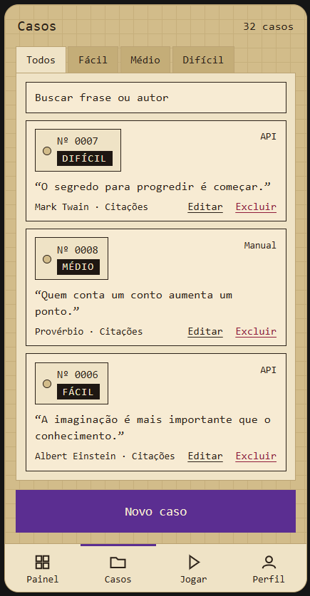
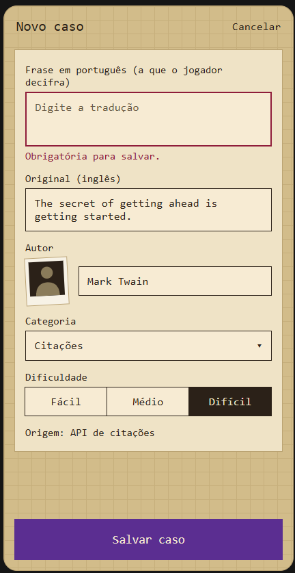

# Criptograma

Um aplicativo Android de jogo de criptogramas, em que o jogador decifra mensagens codificadas por meio de substituição de letras.

## O que é um criptograma

Criptograma é um quebra-cabeça em que uma frase ou citação aparece cifrada. Cada letra do texto original foi trocada por outra, sempre do mesmo jeito dentro da mesma mensagem. Por exemplo, se o A virou X, toda ocorrência de A aparece como X. O objetivo é descobrir a correspondência entre as letras e revelar o texto original, usando pistas como palavras curtas, letras repetidas e padrões do idioma.

## Sobre o projeto

Este projeto é um jogo de criptogramas para Android, desenvolvido em Kotlin. O jogador recebe uma frase cifrada, tenta substituir letras e verifica se está no caminho certo até decifrar a mensagem completa.

## Status

Em desenvolvimento inicial.

## Processo de desenvolvimento

Primeiramente começamos decidindo quais são as telas que serão desenvolvidas e que cumprem os requisitos, e criamos um mockup para servir de referência visual para decidir as features o design das telas.

Tela inicial:

Tela dos casos(criptogramas):

Tela do jogo:

Tela do resultado:

Tela do ranking e histórico:

Tela lista dos criptogramas para o admin:

Tela do formulário:

